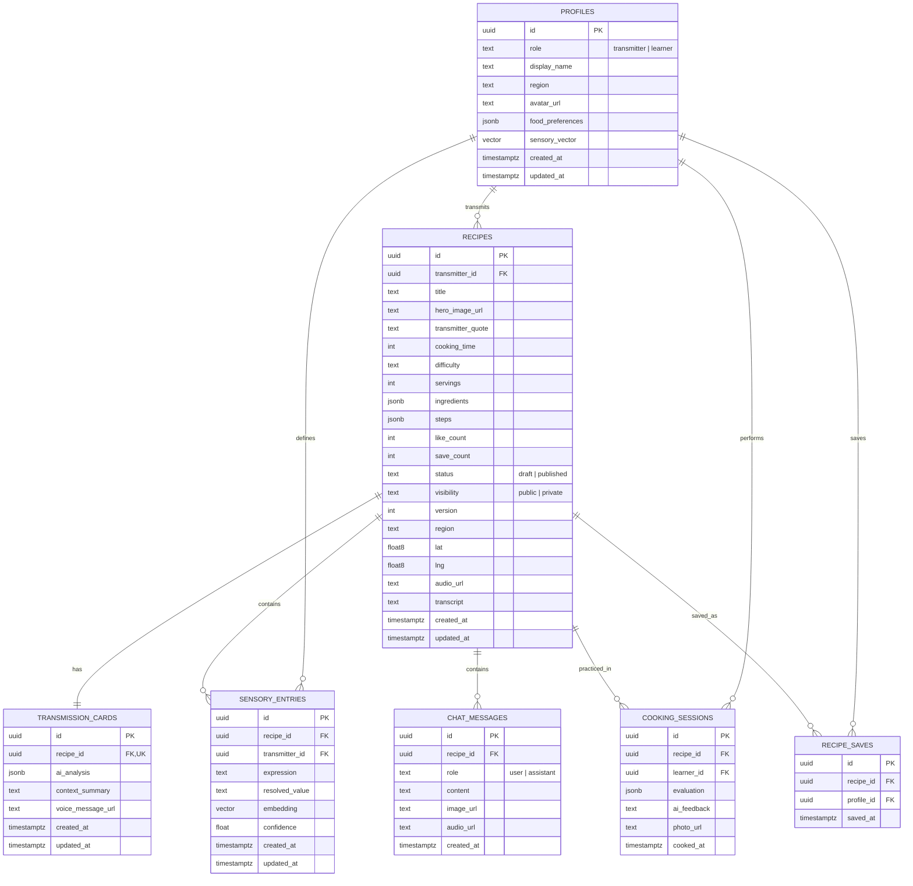

# ERD

> **버전**: 0.1 | **작성일**: 2026-11-02 | **작성자**: BE
>

---

## 1. Entity Relationship Diagram



---

## 2. PostgreSQL DDL

```sql
CREATE EXTENSION IF NOT EXISTS vector;

CREATE TABLE profiles (
  id                  UUID PRIMARY KEY REFERENCES auth.users(id) ON DELETE CASCADE,
  role                TEXT NOT NULL CHECK (role IN ('transmitter', 'learner')),
  display_name        TEXT NOT NULL,
  region              TEXT,
  region_code         TEXT,
  avatar_url          TEXT,
  bio                 TEXT,
  food_preferences    JSONB NOT NULL DEFAULT '[]'::jsonb,
  sensory_vector      vector(1536),
  created_at          TIMESTAMPTZ NOT NULL DEFAULT now(),
  updated_at          TIMESTAMPTZ NOT NULL DEFAULT now()
);

CREATE TABLE recipes (
  id                  UUID PRIMARY KEY DEFAULT gen_random_uuid(),
  transmitter_id      UUID NOT NULL REFERENCES profiles(id) ON DELETE CASCADE,
  title               TEXT,
  status              TEXT NOT NULL DEFAULT 'draft' CHECK (status IN ('draft', 'published')),
  CHECK (status <> 'published' OR (title IS NOT NULL AND length(btrim(title)) > 0)),
  hero_image_url      TEXT,
  transmitter_quote   TEXT,
  cooking_time        INT CHECK (cooking_time > 0),
  difficulty          TEXT CHECK (difficulty IN ('쉬움', '보통', '어려움')),
  servings            INT CHECK (servings > 0),
  ingredients         JSONB NOT NULL DEFAULT '[]'::jsonb,
  steps               JSONB NOT NULL DEFAULT '[]'::jsonb,
  like_count          INT NOT NULL DEFAULT 0 CHECK (like_count >= 0),
  save_count          INT NOT NULL DEFAULT 0 CHECK (save_count >= 0),
  visibility          TEXT NOT NULL DEFAULT 'private' CHECK (visibility IN ('public', 'private')),
  version             INT NOT NULL DEFAULT 1 CHECK (version >= 1),
  region              TEXT,
  region_code         TEXT,
  lat                 DOUBLE PRECISION,
  lng                 DOUBLE PRECISION,
  audio_url           TEXT,
  transcript          TEXT,
  created_at          TIMESTAMPTZ NOT NULL DEFAULT now(),
  updated_at          TIMESTAMPTZ NOT NULL DEFAULT now()
);

CREATE TABLE transmission_cards (
  id                  UUID PRIMARY KEY DEFAULT gen_random_uuid(),
  recipe_id           UUID NOT NULL UNIQUE REFERENCES recipes(id) ON DELETE CASCADE,
  ai_analysis         JSONB NOT NULL DEFAULT '{}'::jsonb,
  context_summary     TEXT,
  voice_message_url   TEXT,
  created_at          TIMESTAMPTZ NOT NULL DEFAULT now(),
  updated_at          TIMESTAMPTZ NOT NULL DEFAULT now()
);

CREATE TABLE sensory_entries (
  id                  UUID PRIMARY KEY DEFAULT gen_random_uuid(),
  recipe_id           UUID REFERENCES recipes(id) ON DELETE SET NULL,
  transmitter_id      UUID NOT NULL REFERENCES profiles(id) ON DELETE CASCADE,
  expression          TEXT NOT NULL,
  resolved_value      TEXT NOT NULL,
  embedding           vector(1536),
  confidence          REAL CHECK (confidence BETWEEN 0 AND 1),
  created_at          TIMESTAMPTZ NOT NULL DEFAULT now(),
  updated_at          TIMESTAMPTZ NOT NULL DEFAULT now(),
  UNIQUE (transmitter_id, expression)
);

CREATE TABLE chat_messages (
  id                  UUID PRIMARY KEY DEFAULT gen_random_uuid(),
  recipe_id           UUID NOT NULL REFERENCES recipes(id) ON DELETE CASCADE,
  role                TEXT NOT NULL CHECK (role IN ('user', 'assistant')),
  content             TEXT NOT NULL,
  image_url           TEXT,
  audio_url           TEXT,
  created_at          TIMESTAMPTZ NOT NULL DEFAULT now()
);

CREATE TABLE cooking_sessions (
  id                  UUID PRIMARY KEY DEFAULT gen_random_uuid(),
  recipe_id           UUID NOT NULL REFERENCES recipes(id) ON DELETE CASCADE,
  learner_id          UUID NOT NULL REFERENCES profiles(id) ON DELETE CASCADE,
  evaluation          JSONB,
  ai_feedback         TEXT,
  photo_url           TEXT,
  cooked_at           TIMESTAMPTZ NOT NULL DEFAULT now()
);

CREATE TABLE recipe_saves (
  id                  UUID PRIMARY KEY DEFAULT gen_random_uuid(),
  recipe_id           UUID NOT NULL REFERENCES recipes(id) ON DELETE CASCADE,
  profile_id          UUID NOT NULL REFERENCES profiles(id) ON DELETE CASCADE,
  saved_at            TIMESTAMPTZ NOT NULL DEFAULT now(),
  UNIQUE (recipe_id, profile_id)
);
```

---

## 3. JSONB 필드 구조

### `profiles.food_preferences`

```json
["탕·찌개", "구이", "찜·조림"]
```

### `recipes.ingredients`

```json
[
  {"name": "소고기 양지", "amount": 300, "unit": "g", "optional": false},
  {"name": "무", "amount": 350, "unit": "g", "display_amount": "1/3개"}
]
```

### `recipes.steps`

```json
[
  {
    "order": 1,
    "title": "재료 손질하기",
    "description": "소고기의 핏물을 제거하고 채소를 손질한다.",
    "image_url": "https://...",
    "real_photo_url": null,
    "tip": "핏물을 제거하면 국물이 맑아져요.",
    "is_key_step": false
  }
]
```

### `transmission_cards.ai_analysis`

```json
{
  "must_keep": ["국물이 거의 없어질 때까지 졸이기"],
  "can_change": ["당면 또는 감자는 선택"],
  "unresolved": ["등갈비 두 팩의 정확한 중량"],
  "context": {
    "occasion": "가족 식사",
    "for_whom": "가족",
    "tools": ["밥숟가락", "냄비"]
  }
}
```

### `cooking_sessions.evaluation`

```json
{
  "salt": 0,
  "consistency": 1,
  "doneness": 0,
  "overall": 2,
  "rule_followed": true
}
```

> `salt`·`consistency`·`doneness`: -2(부족) ~ 0(적당) ~ +2(과함)
>
>
> `overall`: 1(아직 멀다) / 2(거의 같다) / 3(바로 그 맛)
>
> `rule_followed`: 전승자가 지정한 "꼭 지켜야 할 것" 준수 여부
>

---

## 4. 인덱스

```sql
CREATE INDEX idx_recipes_transmitter ON recipes(transmitter_id);
CREATE INDEX idx_recipes_region ON recipes(region);
CREATE INDEX idx_recipes_popular ON recipes(like_count DESC, created_at DESC);
CREATE INDEX idx_chat_messages_recipe ON chat_messages(recipe_id, created_at);
CREATE INDEX idx_sensory_transmitter ON sensory_entries(transmitter_id, expression);
CREATE INDEX idx_cooking_sessions_learner ON cooking_sessions(learner_id, cooked_at DESC);
CREATE INDEX idx_recipe_saves_profile ON recipe_saves(profile_id, saved_at DESC);

CREATE INDEX idx_profiles_sensory_vector ON profiles
  USING ivfflat (sensory_vector vector_cosine_ops)
  WITH (lists = 10);
```

---

## 5. Row-Level Security

```sql
CREATE TABLE recipe_likes (
  recipe_id UUID NOT NULL REFERENCES recipes(id) ON DELETE CASCADE,
  profile_id UUID NOT NULL REFERENCES profiles(id) ON DELETE CASCADE,
  PRIMARY KEY (recipe_id, profile_id)
);

ALTER TABLE recipe_likes ENABLE ROW LEVEL SECURITY;

CREATE POLICY own_recipe_likes ON recipe_likes
  FOR SELECT USING (profile_id = auth.uid());

ALTER TABLE profiles ENABLE ROW LEVEL SECURITY;
ALTER TABLE recipes ENABLE ROW LEVEL SECURITY;
ALTER TABLE transmission_cards ENABLE ROW LEVEL SECURITY;
ALTER TABLE sensory_entries ENABLE ROW LEVEL SECURITY;
ALTER TABLE chat_messages ENABLE ROW LEVEL SECURITY;
ALTER TABLE cooking_sessions ENABLE ROW LEVEL SECURITY;
ALTER TABLE recipe_saves ENABLE ROW LEVEL SECURITY;

-- Application routes mediate recipe and card access.
REVOKE ALL ON recipes, transmission_cards, chat_messages, recipe_likes, recipe_saves FROM PUBLIC, anon, authenticated;

CREATE POLICY own_profile ON profiles
  USING (id = auth.uid())
  WITH CHECK (id = auth.uid());

CREATE POLICY public_recipe_read ON recipes
  FOR SELECT USING (status = 'published' AND visibility = 'public');

CREATE POLICY transmitter_manage_recipe ON recipes
  FOR ALL USING (transmitter_id = auth.uid())
  WITH CHECK (transmitter_id = auth.uid());

CREATE POLICY transmitter_manage_card ON transmission_cards
  FOR ALL USING (recipe_id IN (
    SELECT id FROM recipes WHERE transmitter_id = auth.uid()
  ));

CREATE POLICY own_sensory_entries ON sensory_entries
  FOR ALL USING (transmitter_id = auth.uid())
  WITH CHECK (transmitter_id = auth.uid());

CREATE POLICY recipe_chat_access ON chat_messages
  FOR ALL USING (recipe_id IN (
    SELECT id FROM recipes WHERE transmitter_id = auth.uid()
  ));

CREATE POLICY own_cooking_sessions ON cooking_sessions
  FOR ALL USING (learner_id = auth.uid())
  WITH CHECK (learner_id = auth.uid());

CREATE POLICY own_recipe_saves ON recipe_saves
  FOR ALL USING (profile_id = auth.uid())
  WITH CHECK (profile_id = auth.uid());
```

> 레시피·카드 조회는 서버 전용 클라이언트에서 처리한다. 서버가 사용자 인증, 작성자 확인, 공개·발행 조건을 적용한 뒤 허용된 필드만 반환한다. 좋아요·저장은 서버에서 검증한 사용자로 DB 트랜잭션을 호출해 관계 행과 카운터를 함께 변경한다.
>
> 공개 레시피 응답에서는 `transcript`, `ai_analysis`, 원본 음성 URL처럼 내부 인터뷰 데이터가 노출되지 않도록 API 응답 DTO에서 제외한다.
>

---

## 6. Storage 경로

```
recipe-audio/{transmitter_id}/{recipe_id}/original.webm
recipe-images/{transmitter_id}/{recipe_id}/hero.webp
chat-images/{transmitter_id}/{recipe_id}/{message_id}.webp
tts/{transmitter_id}/{recipe_id}/{message_id}.mp3
card-voice/{transmitter_id}/{recipe_id}/message.webm
step-images/{transmitter_id}/{recipe_id}/{step_order}.webp
step-photos/{transmitter_id}/{recipe_id}/{step_order}.webp
```

- 직접 업로드의 임시 경로는 비공개 uploads 버킷의 {user_id}/{purpose}/{uuid}.{ext} 형식을 사용한다. 서버에서 발급 기록과 객체를 확인한 후 연결한다.
- API에서 권한을 확인한 후 짧은 만료 시간의 signed URL을 발급한다.
- 초안과 비공개 레시피의 미디어는 비공개 버킷에 보관한다.
