# 시스템 아키텍처

> **버전**: 0.1 | **작성일**: 2026-11-02 | **작성자**: BE
>

---

## 1. 서비스 개요

**한술**은 경북 종가 음식에 담긴 **감각어("쪼매", "자작하게", "푹" 등)를 AI가 수치화**해 다음 세대도 재현 가능한 레시피로 전승하는 서비스입니다.

- **전승자** (할머니·부모): 음성으로 레시피를 말하면 AI가 감각어를 탐지하고 채팅으로 보완 질문
- **학습자** (자녀·손자): 레시피 목록·상세 페이지에서 전승자 한 마디와 재료·단계를 확인하고 단계별로 따라 만들기
- **지역 확장**: 경북 종가 레시피 핀 지도 → 전국 손맛 아카이브로 확장 가능

---

## 2. 전체 아키텍처

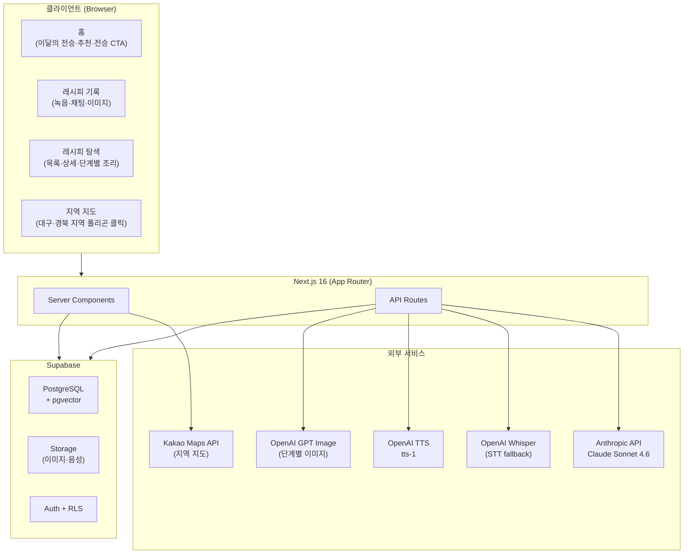

---

## 3. 기술 스택

파일은 Supabase Storage 서명 업로드로 직접 전송하고 Route Handlers에는 경로만 전달한다. 배포 API 계약은 API 명세서를 기준으로 한다.

| 레이어 | 선택 | 선택 이유 |
| --- | --- | --- |
| **프레임워크** | Next.js 16 (App Router) | API Routes로 별도 서버 불필요 — 해커톤 배포 속도 최우선 |
| **언어** | TypeScript | AI 연동 엣지 케이스가 많아 타입 안전성 필수 |
| **DB** | Supabase (PostgreSQL + pgvector) | RLS로 사용자별 데이터 격리 + 실시간 구독 + Storage 한 번에 해결 |
| **AI (채팅)** | Claude Sonnet 4.6 | 한국어 방언 처리 성능 |
| **STT** | Web Speech API + Whisper | Web Speech: 비용 제로 / Whisper: 방언 정확도 fallback |
| **이미지 생성** | GPT Image | 서버 IMAGE_MODEL 설정 및 OpenAI API 키 사용 |
| **TTS** | OpenAI `tts-1` | 스트리밍 응답 지원, OpenAI 키 재사용 |
| **지도** | Kakao Maps + 공공데이터포털 GeoJSON | Kakao Maps: 베이스 맵·주소 / GeoJSON: 경북 시·군 행정구역 경계 폴리곤 (정적 파일로 번들) |
| **배포** | Vercel | GitHub 연동 자동 배포 |
| **스타일** | Tailwind CSS + shadcn/ui | 빠른 UI 조립 |

---

## 4. 주요 기능 흐름

### 4.1 레시피 전승 플로우 (전승자)

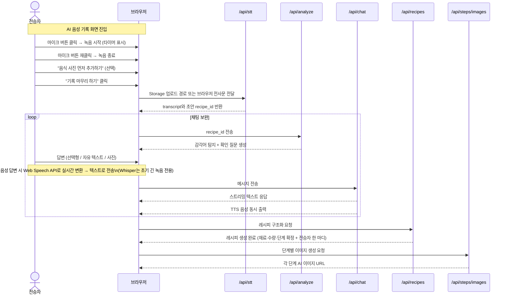

### 4.2 레시피 조회 플로우 (학습자)

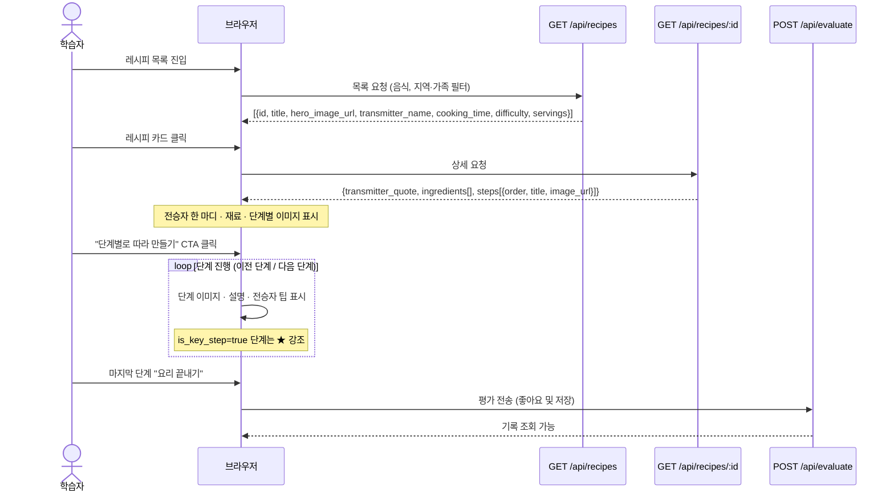

### 4.3 지도 플로우

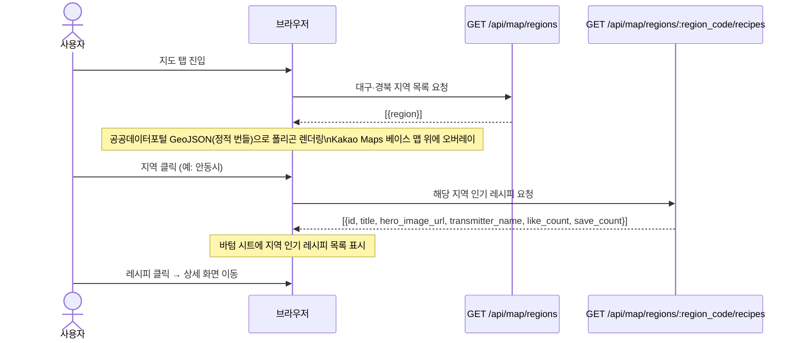

### 4.4 온보딩 플로우 (최초 실행)

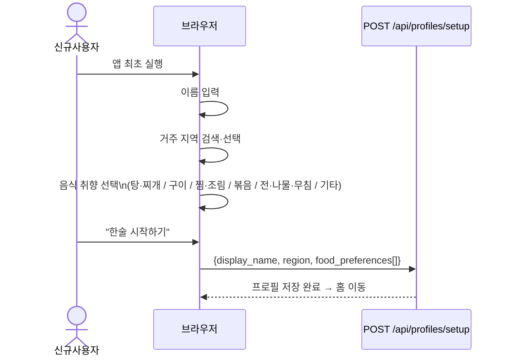

### 4.5 홈 화면 플로우

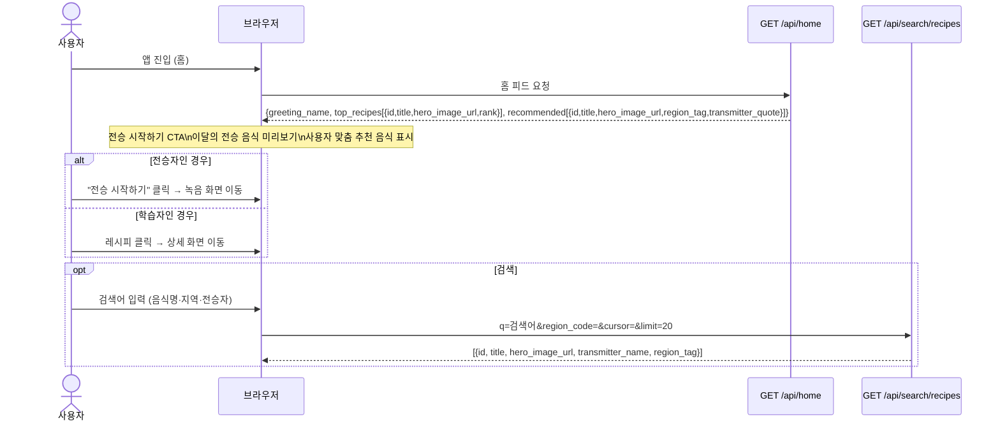

### 4.6 프로필 플로우

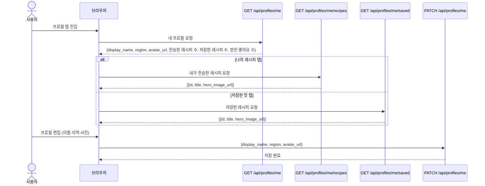

### 4.7 AI 파이프라인 (Claude 3-pass)

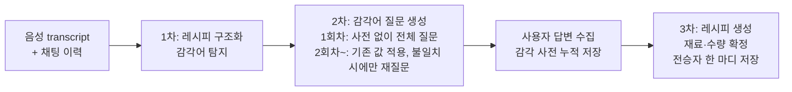

### 4.8 감각 사전 재활용 플로우 (2회차 이상)

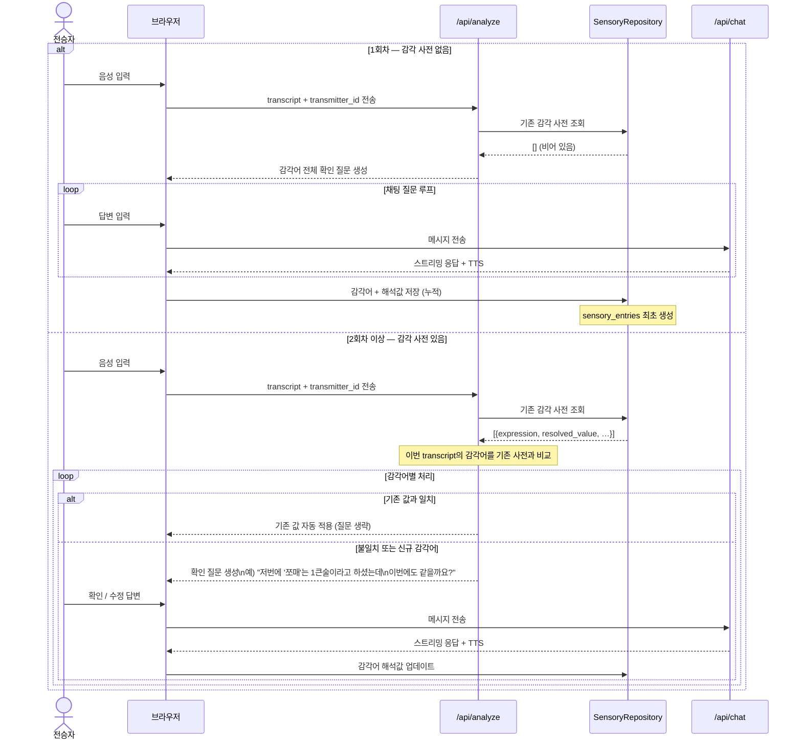

---

## 5. 백엔드 레이어 구조

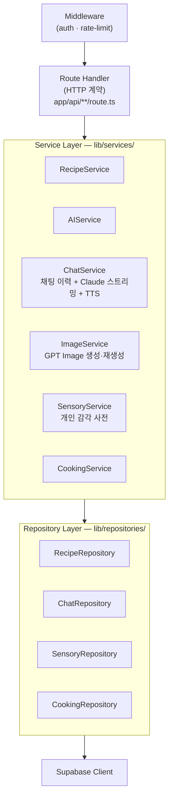

---

## 6. API 엔드포인트

| 메서드 | 경로 | 설명 |
| --- | --- | --- |
| `GET` | `/api/home` | 홈 피드 (인사말 + 이달의 TOP + 개인화 추천 통합) |
| `GET` | `/api/search/recipes` | 음식명·지역·전승자 통합 검색 |
| `POST` | `/api/stt` | Whisper STT (음성 → 텍스트) |
| `POST` | `/api/analyze` | 감각어 탐지 + 확인 질문 생성 |
| `POST` | `/api/chat` | 채팅 스트리밍 + TTS 동시 출력 |
| `GET` | `/api/recipes` | 레시피 목록 조회 (지역 필터) |
| `GET` | `/api/recipes?sort=popular` | 이달의 전승 음식 TOP N (like_count + COUNT(recipe_saves) 기준) |
| `GET` | `/api/recipes/:id` | 레시피 상세 조회 (전승자 한 마디 + 재료 + 단계별 이미지 포함) |
| `POST` | `/api/recipes` | 레시피 생성 (AI 처리 결과 저장) |
| `POST` | `/api/recipes/:id/like` | 좋아요 토글 → like_count 업데이트 |
| `POST` | `/api/recipes/:id/save` | 저장 토글 → recipe_saves 레코드 추가·삭제 |
| `GET` | `/api/recommendations` | 개인화 추천 (food_preferences 기반) |
| `POST` | `/api/profiles/setup` | 온보딩 프로필 저장 (이름·지역·음식 취향) |
| `GET` | `/api/profiles/me` | 내 프로필 조회 (통계 포함: 전승·저장·좋아요 수) |
| `PATCH` | `/api/profiles/me` | 프로필 편집 (이름·지역·사진) |
| `GET` | `/api/profiles/me/recipes` | 내가 전승한 레시피 목록 |
| `GET` | `/api/profiles/me/saved` | 저장한 레시피 목록 |
| `POST` | `/api/recipes/:id/voice` | 전승자 한 마디 음성 업로드 |
| `POST` | `/api/steps/images` | 단계별 AI 이미지 일괄 생성 |
| `POST` | `/api/steps/:order/image` | 단계별 이미지 재생성 |
| `POST` | `/api/steps/:order/photo` | 완성 단계 실제 사진 업로드 |
| `POST` | `/api/sensory/vectorize` | 감각 사전 → 벡터 변환·저장 |
| `POST` | `/api/evaluate` | 조리 평가 저장 (좋아요·기록) → 조리 이력 조회 가능 |
| `GET` | `/api/map/regions` | 대구·경북 지역 목록 (시·군 단위) |
| `GET` | `/api/map/regions/:region_code/recipes` | 선택 지역 인기 레시피 목록 |

---

## 7. 데이터 모델

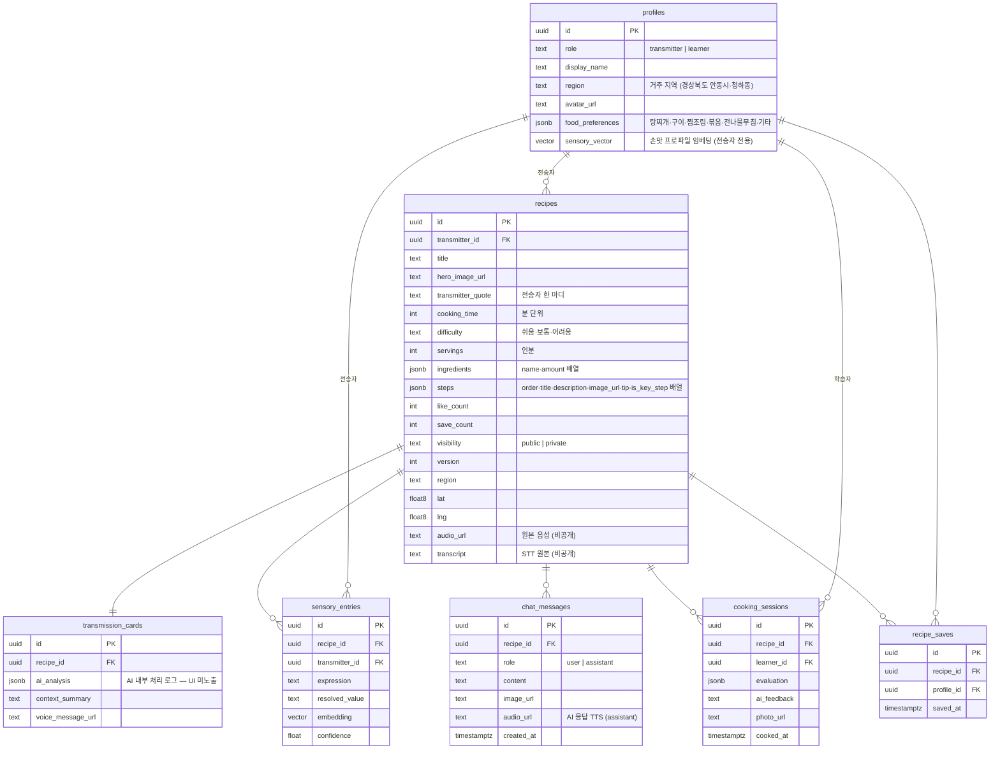

---

## 8. 배포 구성

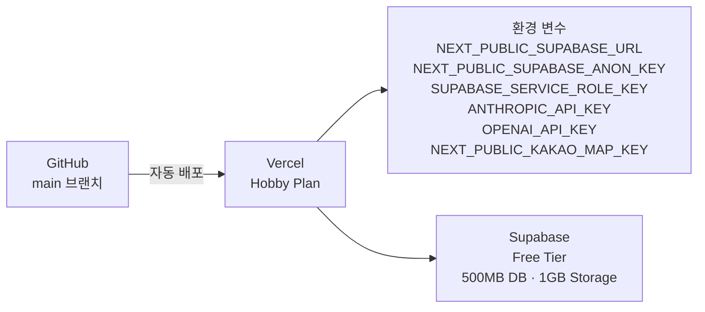

**인프라 비용 (해커톤 기간)**: Vercel Hobby + Supabase Free → 무료

---

## 9. 설계 결정 사항

| 결정 | 선택 | 대안 | 이유 |
| --- | --- | --- | --- |
| 레시피 조회 UI = 상세 페이지 | 별도 "전승카드" 뷰 없이 레시피 상세 페이지에 전승자 한 마디·재료·단계 통합 | 전승카드 별도 화면 | UI 단순화 — 학습자가 한 화면에서 맥락+레시피를 모두 파악 |
| AI 감각어 정답 생성 금지 | Claude가 추정하지 않고 전승자에게 반드시 확인 | AI가 자동 추정 | 손맛의 본질은 개인 감각 — AI 추정값은 전승 왜곡 |
| 채팅 TTS 동시 스트리밍 | 텍스트 스트림 + 음성 병렬 출력 | 텍스트 완성 후 TTS | 전승자 경험: 대화처럼 느껴져야 함 |
| 마지막 단계 실제 사진 | AI 이미지 생략, 실제 촬영 유도 | 전 단계 AI 이미지 생성 | 완성품 신뢰도 — "직접 만든 음식"임을 강조 |
| Supabase RLS | `transmitter_id = auth.uid()` 기반 데이터 격리 | 앱 레벨 필터 | DB 레벨 보안이 누락 방지에 확실 |
| pgvector 손맛 임베딩 | 개인 감각 사전 → 벡터 저장 | 텍스트 비교 | 향후 유사 손맛 추천·클러스터 지도 확장 대비 |

---

## 주요 리스크 및 대응

| 리스크 | 대응 |
| --- | --- |
| Web Speech API 방언 인식 불량 | Whisper fallback + 텍스트 직접 입력 병행 |
| Claude 응답 latency 8초+ | 스트리밍 + skeleton UI + 데모용 mock 모드 분리 |
| 콜드 스타트 빈 지도 | 시드 데이터 5레시피 사전 삽입 |
| 감각 사전 데이터 부족 (1회차) | 1회차는 전체 질문 후 누적만, 2회차부터 기존 값 재활용 + 불일치 시에만 재질문 |
